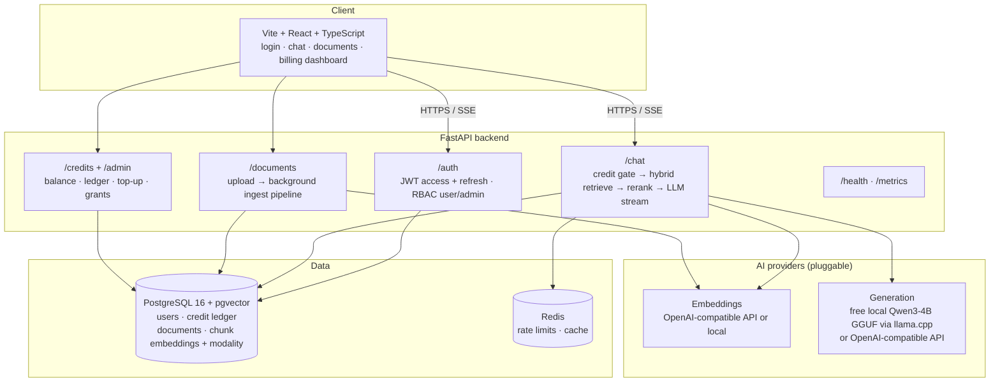
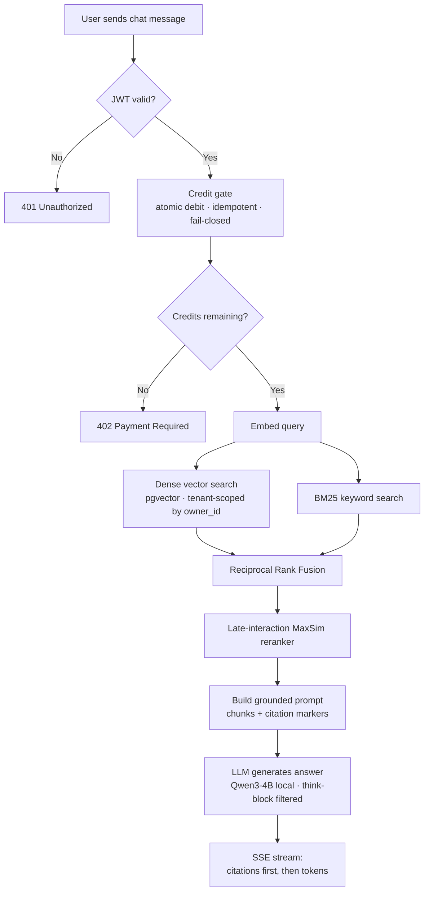
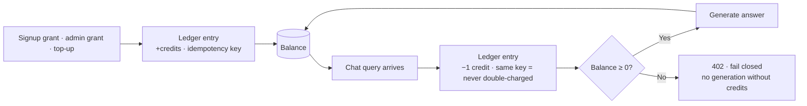

# Knowbase

Production-grade starter for a multi-tenant Retrieval-Augmented Generation
platform: JWT auth, credit-based billing, document ingestion, pgvector
retrieval, streaming chat with citations.

## Architecture

```
                         ┌──────────────────────────┐
                         │        Frontend (web)      │
                         │  Vite + React + TS        │
                         │  login · chat · docs ·    │
                         │  billing dashboard        │
                         └────────────┬─────────────┘
                                      │ HTTPS / SSE
                         ┌────────────▼─────────────┐
                         │       API (FastAPI)       │
                         │                          │
  ┌──────────────────────►  /auth      JWT access +  │
  │                      │             refresh, RBAC │
  │                      │  /chat      credit gate ──┼──► deduct (FOR UPDATE)
  │                      │             → retrieve    │
  │                      │             → rerank*     │
  │                      │             → LLM stream  │
  │                      │  /documents upload →      │
  │                      │             background    │
  │                      │             ingest pipeline│
  │                      │  /credits   balance,      │
  │                      │             ledger, topup │
  │                      │  /admin     grants, users │
  │                      │  /health,/metrics        │
  └──────────────────────┴────────────┬─────────────┘
                                      │
            ┌─────────────────────────┼─────────────────────────┐
            │                         │                         │
   ┌────────▼────────┐        ┌────────▼────────┐       ┌────────▼────────┐
   │ Postgres 16     │        │ Redis           │       │ OpenAI-compat   │
   │ + pgvector      │        │ rate limits,    │       │ embeddings +    │
   │ users, credits  │        │ cache           │       │ chat (pluggable)│
   │ ledger, docs,   │        └─────────────────┘       └─────────────────┘
   │ chunk embeddings│
   │ + modality meta │
   └─────────────────┘
   * rerank = late-interaction MaxSim (built-in); cross-encoder seam available.
   * LLM = OpenAI-compatible API or free local GGUF (LLM_PROVIDER=local).
```

**Request flow (chat):** `credit_gate` dependency deducts credits *before*
generation (fail-closed, idempotent) → embed query → **hybrid retrieval**
(dense vector + BM25 fused with RRF, tenant-scoped by `owner_id`) →
**late-interaction rerank** → LLM streams tokens as SSE with citations sent first.

**Ingestion flow (multimodal):** upload → type router (`extractors.py`):
PDF (per-page), PPTX (per-slide), DOCX, TXT/MD/CSV, images (metadata +
optional vision captions), audio/video (ffmpeg → faster-whisper transcription
with timestamps) → chunk → embed → upsert with modality/page metadata.

### Diagrams

**System architecture**



**Chat request flow (retrieval → generation)**



**Credit ledger flow**



> Stripe top-up is stubbed — there is no credit→USD mapping yet.

## Quick start (local, no Docker)

Prereqs: Python 3.12+, Node 24+, Postgres 16 + pgvector extension, Redis
(or use `VECTOR_BACKEND=memory`, `EMBEDDING_PROVIDER=fake` for a zero-dep run).

```bash
# 1. Backend
cd backend
python -m venv .venv && source .venv/bin/activate
pip install -r requirements.txt
cp ../infra/.env.example .env        # edit secrets!
alembic upgrade head
uvicorn app.main:app --reload        # http://localhost:8000/docs

# 2. Frontend
cd ../frontend
npm install
npm run dev                          # http://localhost:5173
```

Zero-dependency demo mode (no Postgres/Redis/OpenAI):

```bash
# backend/.env
VECTOR_BACKEND=memory
EMBEDDING_PROVIDER=fake
DATABASE_URL=sqlite:///./dev.db   # tests use sqlite; dev needs the pgvector
                                   # tables - memory backend keeps chunks in-RAM
```

> Note: the `document_chunks` table needs pgvector DDL, so full local dev
> without Postgres is limited to auth/credits/chat-over-empty-index. Use
> Docker for the real thing.

## Docker (recommended)

```bash
cp infra/.env.example infra/.env   # fill in JWT_SECRET_KEY, OPENAI_API_KEY
docker compose -f infra/docker-compose.yml up --build
# API: http://localhost:8000/docs   Web: http://localhost:3000
```

Migrations run automatically before the API starts (`alembic upgrade head`).

## Environment variables

All config is env-driven (`backend/app/core/config.py`). Full list with
defaults: [`infra/.env.example`](infra/.env.example). Key ones:

| Var | Purpose |
|---|---|
| `JWT_SECRET_KEY` | HS256 signing key (`openssl rand -hex 32`) |
| `DATABASE_URL` | SQLAlchemy URL |
| `REDIS_URL` | Rate limiting / cache |
| `EMBEDDING_PROVIDER` | `openai` or `fake` |
| `OPENAI_API_KEY` / `OPENAI_BASE_URL` | Any OpenAI-compatible endpoint |
| `VECTOR_BACKEND` | `pgvector` or `memory` |
| `CREDITS_PER_CHAT_QUERY` | Cost per chat call |
| `STRIPE_SECRET_KEY` | Empty = stubbed top-up; set = must finish Stripe |

## API surface

| Method | Path | Auth | Notes |
|---|---|---|---|
| POST | `/api/v1/auth/register` | – | + signup bonus credits |
| POST | `/api/v1/auth/login` | – | |
| POST | `/api/v1/auth/refresh` | – | refresh token |
| GET | `/api/v1/auth/me` | user | |
| POST | `/api/v1/chat` | user | SSE stream, 1 credit, 402 if broke |
| POST | `/api/v1/chat/ask` | user | JSON fallback |
| POST | `/api/v1/documents/upload` | user | → 202, background ingest |
| GET/DELETE | `/api/v1/documents…` | user | tenant-scoped |
| GET | `/api/v1/credits/balance`, `/history` | user | |
| POST | `/api/v1/credits/topup` | user | stubbed until Stripe wired |
| POST | `/api/v1/admin/credits/grant` | admin | |
| GET | `/api/v1/admin/users` | admin | |
| GET | `/api/v1/health`, `/ready`, `/metrics` | – | |

Idempotency: send `Idempotency-Key` header on `/chat` and `/credits/topup`
— replays never double-charge.

## What's stubbed vs production-ready

**Production-ready:** JWT access+refresh, bcrypt, RBAC, credit ledger with
row-locked atomic deductions, idempotent billing, Alembic migrations,
structured JSON logs, request IDs, Prometheus metrics, health/readiness,
rate limiting, SSE streaming chat, tenant-scoped **hybrid retrieval**
(dense + BM25 fused with RRF), **late-interaction reranker** (ColBERT-style
MaxSim), **multimodal ingestion** (PDF/PPTX/DOCX/TXT/images/audio/video),
**free local LLM** (`LLM_PROVIDER=local`, Qwen3-4B GGUF via llama.cpp).

**Stubbed (clear TODOs in code):**
- Stripe top-up: credits instantly in demo mode; wire Checkout Session +
  webhook signature verification (`credits.py`, README deploy notes).
- Cross-encoder reranker: seam ready (`RERANKER=cross-encoder`); default is the
  built-in late-interaction reranker, no downloads needed.
- Image understanding: images ingest as metadata segments; wire the
  `LOCAL_VISION_MODEL_PATH` GGUF (moondream2) for captions/OCR-free VQA.
- Scanned PDFs need OCR (Tesseract/Textract) — text PDFs work out of the box.
- OAuth: `security.OAUTH_PROVIDERS` registry + `/oauth/{provider}/login` 501s.
- Token store in frontend is localStorage — move to httpOnly cookies + CSRF.
- Refresh-token rotation/revocation (currently stateless long-lived).

## Deployment notes (AWS / GCP)

- **Compute:** API on ECS/Fargate or Cloud Run (2+ replicas); web on
  CloudFront + S3 / Cloud CDN. The Dockerfiles are distroless-friendly.
- **Data:** RDS Postgres 16 with pgvector (or AlloyDB / Cloud SQL for
  PostgreSQL + `vector` extension); ElastiCache/Memorystore Redis.
- **Secrets:** never env-file in prod — use Secrets Manager / Secret Manager,
  injected as env vars. Rotate `JWT_SECRET_KEY` with dual-key support.
- **Migrations:** run `alembic upgrade head` as a release job (ECS task /
  Cloud Run job), not in the web boot path.
- **Background ingestion:** replace FastAPI `BackgroundTasks` with a durable
  queue (SQS + worker tasks / Cloud Tasks) so uploads survive restarts and
  scale independently.
- **Observability:** ship JSON logs to CloudWatch/Datadog; scrape `/metrics`
  with Prometheus/GMP; alert on 5xx rate, p95 latency, credit-deduction
  errors, and ingestion failure rate.

## Security checklist

- [ ] `JWT_SECRET_KEY` ≥ 256 bits, unique per environment
- [ ] HTTPS everywhere (ALB/Cloud Load Balancer terminates TLS)
- [ ] CORS restricted to your frontend origins
- [ ] Rate limits tuned; WAF in front of `/auth/*`
- [ ] DB credentials in a secrets manager; least-privilege DB user
- [ ] Stripe webhook signature verification enabled
- [ ] Move frontend tokens to httpOnly cookies; add CSRF protection
- [ ] Refresh-token rotation + revocation list (Redis)
- [ ] Dependency scanning (Dependabot/Renovate) + image scanning in CI
- [ ] Audit log for admin grant/disable actions (ledger covers credits)

## Scaling notes

- **Reads:** pgvector IVFFlat/HNSW index (migration includes IVFFlat;
  switch to HNSW for zero-warmup). Partition `document_chunks` by tenant
  when a single tenant dominates.
- **Writes:** ingestion is the hot path — move to queue workers, batch
  embeddings (already 128/batch), consider a dedicated embedding cache in Redis.
- **Chat:** stateless API scales horizontally; stream via SSE (already) or
  WebSocket; LLM calls dominate latency — set timeouts + fall back to a
  smaller model on 429/5xx.
- **Credits:** row-level locking is correct but contended at very high QPS —
  shard accounts or use Redis-based pre-authorization with async settlement.

## Tests

```bash
cd backend
pytest            # auth + credit suites (sqlite, no external services)
```

## Test & metrics results

Last verified: 2026-10-16 (clean checkout, Python 3.12.3, Node v24.20.0).

| Check | Command | Result |
|---|---|---|
| Backend unit tests | `pytest tests/ -v` | **14/14 passed** in 8.01s — `test_auth.py` (8: register, login, refresh, RBAC) + `test_credits.py` (6: signup bonus, atomic deduction, idempotency, ledger history, 402-on-empty, admin grant) |
| Backend compile | `python -m compileall app tests` | Clean, no errors |
| Frontend typecheck | `npm run typecheck` (`tsc --noEmit`) | Passed |
| Frontend production build | `npm run build` (`tsc` + `vite build`) | Passed — 39 modules, `dist/` emitted (JS 179.3 kB / 58.2 kB gzip) |
| Health endpoint (live) | `GET /api/v1/health` via TestClient | **200** `{"status": "ok"}` |
| Prometheus metrics (live) | `GET /api/v1/metrics` via TestClient | **200**, valid Prometheus exposition format (~3.6 kB, incl. `python_info`) |
| Docker Compose config | `docker compose config` | **Not validated** — Docker is not installed in this environment |
| Alembic migrations | `alembic upgrade head` | Config present (`alembic.ini`); not run against live Postgres here (needs `DATABASE_URL`) |

**Findings fixed during this run:**
- `requirements.txt` was missing `email-validator` (required by pydantic `EmailStr`); tests failed at import until it was installed. Fixed by adding `email-validator>=2.0` to `backend/requirements.txt`.
- Test-only warnings (non-blocking): short HMAC test key triggers `InsecureKeyLengthWarning` (test config only — use a 32+ byte `JWT_SECRET_KEY` in real envs); Starlette deprecation notice about `httpx` TestClient.

## RAG evaluation results

Last evaluated: 2026-10-16. Harness: `backend/eval/` (run with `cd backend && .venv/bin/python -m eval.run_eval`).
Corpus: 14 synthetic docs, 10 queries (factoid, multi-hop, unanswerable, noisy, conflicting) with ground-truth relevance.
Full JSON report: `backend/eval/results.json`.

> **Scope caveat:** measured with `FakeEmbeddingProvider` (deterministic lexical
> hash embeddings) + `InMemoryVectorStore`. These numbers validate the retrieval
> *pipeline* (chunking → hybrid search → rerank → cite), not production
> semantic-embedding quality. Re-run with `EMBEDDING_PROVIDER=openai` for
> production-representative scores. Generation/judge used the **free local GGUF**
> (`LLM_PROVIDER=local`, Qwen3-4B Q4_K_M) — scores are real but the
> judge is the same small model (self-judging bias); use a stronger judge for
> production evals.

### Retrieval: hybrid ablation (k=6, 8 answerable queries)

| Mode | Hit Rate | Recall | MRR | NDCG | Ctx Precision |
|---|---|---|---|---|---|
| Dense only | 0.875 | 0.8125 | 0.6813 | 0.6984 | 0.1667 |
| Hybrid (dense + BM25/RRF) | **1.0** | **1.0** | 0.9167 | 0.9164 | 0.2083 |
| Hybrid + late-interaction reranker | **1.0** | **1.0** | **1.0** | **0.9847** | 0.2083 |

Hybrid retrieval fixed the dense-only miss; the reranker then perfected ranking
(MRR 1.0). Context precision stays low because top-6 always fills while most
queries have 1 relevant doc — expected in a high-recall setting.

### Generation (free local LLM, 8 queries)

| Metric | Score (Qwen3-4B as generator + judge) |
|---|---|
| Faithfulness / Groundedness | **1.0000** |
| Answer Relevance | **0.7750** |
| Answer Correctness | **1.0000** |
| Citation Accuracy (structural) | **8/8** — every citation references a retrieved chunk, snippets match, scores present |

Previously with Qwen2.5-0.5B: 0.9077 / 0.9635 / 0.9000. The 4B model improved
faithfulness and correctness to perfect, while the stricter 4B judge scored
answer relevance lower (0.7750) than the lenient 0.5B judge did (0.9635) —
relevance scores are judge-calibration-sensitive and not directly comparable
across model sizes.

Sample answers: "RP-1 kerosene", "1903, 1911", "Chloroplasts", the multi-hop
question answered with both hops. The conflicting-population question surfaced
the 850,000 figure with the judge noting the 1.2M conflict — passed to the user
as designed.

### Multimodal ingestion

| File type | Status | Modality | Retrievable |
|---|---|---|---|
| PDF (`memo.pdf`) | READY | text (page-tracked) | yes |
| PPTX (`deck.pptx`) | READY | text (slide-tracked) | yes |
| DOCX (`notes.docx`) | READY | text | yes |
| PNG (`diagram.png`) | READY | image | yes |
| Audio/video (mp3/wav/mp4/…) | — | transcribed via faster-whisper when installed | ffmpeg present; whisper model downloads on first use |

### Robustness

| Metric | Result |
|---|---|
| Negative Rejection | Abstention branch works **2/2** in isolation, but **effective real-path rate is 0.0**: with default `rag_min_score=0.0` the retrieval gate never filters, so irrelevant chunks always reach the LLM and rejection depends on the model following the "say you don't know" system instruction. **Recommendation:** raise `rag_min_score` to make rejection deterministic. |
| Noise Robustness | Adding 6 distractor docs: Hit Rate −0.125, Recall −0.1875, MRR −0.0375, NDCG −0.0805 (lexical baseline; a semantic embedder + reranker should shrink this gap) |
| Multi-hop Reasoning | **2/2 hops** retrieved and correctly composed by the local LLM in the judged run |
| Conflicting Info Handling | Both conflicting sources surfaced with citations (**2/2**); system has **no adjudication logic** — conflicts pass to the LLM/user unresolved |

### Operational

| Metric | Result |
|---|---|
| Latency p50 / p95 | **48.7 ms / 67.7 ms** over 40 samples — full hybrid path (embed + BM25 rebuild + RRF + MaxSim rerank, 14 docs in memory). Excludes LLM call, which dominates production latency. Local 4B generation runs on CPU (slower than 0.5B; swap model path to downgrade). Note: BM25 index rebuilds per query in this scaffold — move to a persistent sparse index (tantivy/OpenSearch) at scale. |
| Cost per Query | **1 credit** per chat query (config); **$0 marginal** with `LLM_PROVIDER=local` (no API fees); **$ cost n/a** for Stripe (stub, no credit→USD mapping yet) |
| Token Usage | **~382 avg / 399 max** prompt tokens per query (platform `estimate_tokens`, chars/4 heuristic; LLM input only) |
| User Feedback Rate | **n/a** — no feedback endpoint instrumented and no production traffic. Recommended: `POST /api/v1/chat/feedback {message_id, rating}` + weekly thumbs-up/down KPI |

### Eval findings (not fixed — recorded for the roadmap)

- `InMemoryVectorStore` chunk-ID collision **fixed** in this pass (was: per-doc index reused across docs; now: globally unique monotonic IDs matching pgvector semantics).
- Sandbox egress proxy sets `no_proxy`/`NO_PROXY` values that `httpx2` (via `huggingface_hub`) cannot parse — worked around in `app/core/envfix.py` (`hf_download_env()`); keep this if deploying behind similar proxies.
